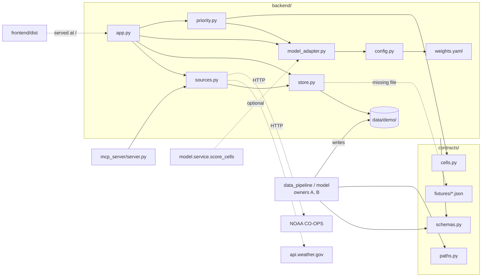

# Design Document: 03-backend-mcp

## Overview

The DrainFast V1 backend (owner C) is a FastAPI app plus an MCP server. Both call the same functions in `backend/sources.py` (tech.md rule 11). The backend reads pipeline outputs from `data/demo/`, falls back to `contracts/fixtures/` per file, builds the priority score, crew brief and backlog in pure functions, and serves the frontend build. Response models come from `contracts.schemas`.

| File | Purpose |
|---|---|
| `backend/config.py` | Environment settings read at call time; weights loaded from `weights.yaml` |
| `backend/store.py` | Loaders for `data/demo/` with fixture fallback and an mtime-keyed cache |
| `backend/sources.py` | `rain_forecast`, `tide_outlook`, `cell_history` (shared by API and MCP) |
| `backend/model_adapter.py` | Normalizes `model.service.score_cells` output; history-only fallback scorer |
| `backend/priority.py` | Pure brief and backlog builders (no I/O, no clock) |
| `backend/weights.yaml` | Every priority weight and brief default |
| `backend/app.py` | FastAPI app, 6 endpoints, CORS, static frontend |
| `mcp_server/server.py` | MCP stdio server with 3 tools |
| `tests/backend/*.py` | pytest + Hypothesis, offline |

Key design decisions:

- **One function per fact.** API endpoints and MCP tools both go through `backend.sources`, so Kiro at build time and the app at run time see identical numbers.
- **Never fails to start.** Every demo file has a fixture twin; network calls return `fallback=true` instead of raising. The full app runs offline with `DRAINFAST_FALLBACK=1`.
- **Pure ranking core.** `priority.py` takes scores, cells and reports as arguments and never reads files or the clock. This makes the property tests direct and keeps leakage rules checkable.
- **Scores are sums.** Every item's `priority_score` is computed by `total(factors)`, so it equals the sum of its factor contributions by construction (tech.md rule 10).
- **Tolerant model interface.** B's `score_cells` return type is not frozen, so the adapter accepts several shapes and degrades to a history-only scorer.
- **Weights in YAML.** All tunable numbers live in `backend/weights.yaml`; code holds no magic weights.

## Architecture

Dependency direction: `contracts` imports nothing from the project; `backend` imports `contracts` and, lazily, `model.service`; `mcp_server` imports only `backend.sources`.

## Components and Interfaces

### backend/config.py

`fallback_on()` (`DRAINFAST_FALLBACK == "1"`), `demo_dir()` (`DRAINFAST_DEMO_DIR` override for tests, else `contracts.paths.DEMO_DIR`), `fixtures_dir()`, `user_agent()` (`DrainFast/1.0 (<DRAINFAST_CONTACT>)`, default contact `team@example.edu`), `frontend_origin()` (default `http://localhost:5173`), and `weights()` (YAML, loaded once).

### backend/store.py

`_load(demo_name, fixture_name, model)` returns `(items, used_fixture)`. It reads the demo file (`.parquet` via pandas or `.json` list), validates each row with the contract model, skips and logs invalid rows, and uses the fixture when the file is missing, unreadable or yields no valid rows. Results are cached with `lru_cache` keyed by `(path, mtime, fixture, model)`, so a rewritten file is picked up without a restart. `_clean` turns NaN/NaT/numpy scalars/Timestamps into plain values.

| Loader | Demo file | Fixture |
|---|---|---|
| `load_reports` | `reports.parquet` | `report.json` |
| `load_cells` | `cells.parquet` | `cell.json` |
| `load_storms` | `storms.parquet` | `storm.json` |
| `load_backtest` | `backtest.json` | `backtest_result.json` |
| `load_rain_trend` | `rain_trend.json` | `rain_trend_point.json` |

`tide_threshold_ft()` reads `tide_threshold.json`: a bare number, or the first numeric value whose key contains `"threshold"`; otherwise `None`.

### backend/sources.py

Returns the dataclasses in Data Models; `as_json(obj)` gives a JSON-safe dict for MCP. Network functions take an injectable `fetch` (default `_http_json`, httpx, 10 s timeout, DrainFast User-Agent on every request).

- `rain_forecast(day)`: GET `api.weather.gov/points/42.3601,-71.0589`, follow `properties.forecastGridData`, read `quantitativePrecipitation.values`. `rain_in_on_day` parses each `validTime` as `<start>/<ISO 8601 duration>` (`parse_duration` handles `PnDTnHnM`), intersects it with the local Boston day `[00:00, 24:00)` in `America/New_York`, and adds millimetres in proportion to the overlap. Using aware datetimes makes the split correct across midnight and DST changes. Result in inches, rounded to 3 places. Successful results are cached for 30 minutes per date (monotonic clock).
- `tide_outlook(day)`: CO-OPS `datagetter`, `product=predictions`, station 8443970, `datum=MLLW`, `units=english`, `time_zone=lst_ldt`, `interval=hilo`. `high_tide_flag = max_ft > threshold`; with no threshold file the flag is False and `note` says so.
- `cell_history(cell_id)`: loads reports and calls pure `history_for`, which filters by cell, sorts newest first (ties by `ticket_id`) and counts `clogged_basin`.
- With fallback on, no fetch is made. Any exception yields `fallback=True`, `rain_in`/`max_ft_mllw` None, and a `note`. Nothing raises.

### backend/model_adapter.py

`score(reports, as_of, rain_in, high_tide, use_model)` returns `({cell_id: CellScore}, used_fallback)`. It lazily imports `model.service.score_cells`; on `ImportError`, any exception, or no usable rows it uses `fallback_scores`.

`normalize_model_output` accepts a DataFrame (`to_dict("records")`) or a list of dicts/objects with `cell_id`. Contributions come from a `contributions` mapping, a list of `{factor, contribution}`, or columns `contrib_<feature>` / `<feature>_contribution`. Non-finite contributions are dropped; `value` is the row's `<feature>` column when numeric, else the contribution. Feature names map to plain language via `PLAIN_NAMES` (for example `past_fixable_count` -> "Past clogged-drain reports"), else `snake_case` -> "Snake case".

`fallback_scores` uses only reports with `opened_at.date() < as_of`. Per cell: `past_clogged * log1p(clogged)`, `past_other * log1p(other)`, `recent_clogged * log1p(clogged in last 365 d)`, `rain_x_history * rain_in * log1p(clogged)`, and `leaf_season * log1p(clogged)` in October and November.

`is_rain_factor` is true for "Forecast rain", "Rain on clogged-drain history", or any name matching `\brain\b` (case-insensitive), so "Past clogged-drain reports" is not dropped.

### backend/priority.py

- `cell_factors(cell, high_tide)`: "Environmental justice area", "Inside modeled flood area", "High tide in flood area" (flood x tide), "Share of basins run by BWSC" (BWSC 1.0, Mixed 0.5, else 0). Each is `weight x value`.
- `build_brief`: for each scored cell, evidence = `evidence_for(cell reports, day, 5)`; cells with no evidence are skipped. Factors = model factors + `cell_factors`. Sort by `(-score, cell_id)`. Add cells while `basins < crews * capacity_per_crew` (and item count below capacity); each cell adds `max(basin_count, 1)`, unknown cells add 1. Ranks are `1..n`. Lat/lon come from the cell, else `contracts.cells.cell_center`, else the first report.
- `reason_for`: "Ranked high mainly because of <a> (<value>) and <b> (<value>)." from the two largest positive factors; a generic sentence when none are positive.
- `evidence_for(reports, before, limit)`: reports opened before `before`, newest first; clogged-drain tickets if any, otherwise all; truncated to `limit`.
- `build_backlog(as_of, limit, ...)`: every open report. Factors = cell factors without rain terms + `cell_factors(high_tide=False)` + `age_factor(age_days)`, where age contributes `age x max(0, 1 - age/365)`. `status_label` is "Status unclear" when `note_blank`, else "Open". Evidence = the case itself, then up to 4 other cell tickets before `as_of`. Sort by `(-score, ticket_id)`, take `limit`.

### mcp_server/server.py

Official MCP SDK low-level `Server("drainfast-data")` over stdio. Tools `rain_forecast(date)`, `tide_outlook(date)`, `cell_history(cell_id)`. `run_tool` dispatches to `backend.sources` and `as_json`; calls run in a worker thread and return one JSON `TextContent`. Logging goes to stderr because stdout carries the protocol.

## Data Models

API responses use `contracts.schemas` models only (Report, BriefResponse, BriefItem, BacklogItem, FactorContribution, BacktestResult, RainTrendPoint), plus a local `HealthResponse` mirroring the OpenAPI component. Internal types:

| Type | Fields | Used by |
|---|---|---|
| `RainForecast` | `date`, `rain_in: float \| None`, `fallback`, `source`, `note` | `rain_forecast`, MCP |
| `TideOutlook` | `date`, `max_ft_mllw`, `threshold_ft_mllw`, `high_tide_flag`, `fallback`, `highs: [{time, ft_mllw}]`, `source`, `note` | `tide_outlook`, MCP |
| `CellHistory` | `cell_id`, `total_reports`, `clogged_basin_reports`, `reports: list[Report]` | `cell_history`, API, MCP |
| `CellScore` (frozen) | `cell_id`, `factors: tuple[FactorContribution, ...]` | model_adapter -> priority |

## Data flow per endpoint

| Endpoint | Flow |
|---|---|
| `GET /health` | `{status: "ok", fallback: fallback_on()}` (local `HealthResponse` mirroring the OpenAPI component) |
| `GET /brief?date&crews&capacity_per_crew=30` | `_weather_for(date)`: past date -> that day's `Storm` from `storms.parquet` (no record -> 0 in, no tide); today/future -> `rain_forecast` + `tide_outlook`, forecast unavailable -> `brief_defaults.fallback_rain_in` (1.0) and `fallback_mode`. Then `load_reports`, `load_cells`, `model_adapter.score` (model skipped in fallback), `priority.build_brief`. `fallback_mode` is also true when `DRAINFAST_FALLBACK=1`. |
| `GET /backlog?limit=50` | Now in Boston; score with rain 0 and no tide; `priority.build_backlog` |
| `GET /cells/{cell_id}/history` | `sources.cell_history`; no reports and not in cells -> 404 `{"detail": "Unknown cell: <id>"}` |
| `GET /backtest` | `store.load_backtest` |
| `GET /rain-trend` | `store.load_rain_trend` |
| `/` | `StaticFiles(frontend/dist, html=True)` when the directory exists |

CORS allows `GET` from `FRONTEND_ORIGIN`. A custom `RequestValidationError` handler returns 422 with `detail` as one string (`"<loc>: <msg>; ..."`).

## Correctness Properties

*A property is a characteristic or behavior that should hold true across all valid executions of a system. Properties bridge human-readable requirements and machine-verifiable checks.*

### Property 1: Factor sum

*For all* generated reports, cells, dates, crews, capacities, rain and tide, every brief and backlog item has `|priority_score - sum(contributions)| <= 1e-6`.

**Validates: Requirements 3.1, 3.2, 3.3, 7.1**

### Property 2: Evidence

*For all* generated inputs, every brief item has at least one evidence ticket, each belonging to the item's cell and opened before the brief date; and the backlog has one item per open report, each with evidence starting with its own ticket ID (test tag 2b).

**Validates: Requirements 4.6, 4.7, 5.1, 5.3, 7.2**

### Property 3: Determinism under shuffle

*For all* generated inputs, shuffling reports and cells gives an identical BriefResponse.

**Validates: Requirements 4.4, 7.3**

### Property 4: Future reports do not change the brief

*For all* generated inputs, adding reports opened on or after the brief date leaves the fallback brief unchanged.

**Validates: Requirements 3.4, 4.6, 7.4**

### Property 5: Capacity

*For all* generated inputs, the brief has at most `crews * capacity_per_crew` items, every item but the last was added while the basin total (0 counted as 1) was under capacity, and ranks are `1..n`.

**Validates: Requirements 4.4**

## Error Handling

- Missing, unreadable or fully invalid demo files fall back to fixtures; invalid rows are skipped and logged (first 3 shown).
- `rain_forecast` and `tide_outlook` catch every exception and return `fallback=True` with a `note`.
- `score_cells` import or runtime errors fall back to the history-only scorer.
- Invalid query parameters -> 422 `{"detail": "<string>"}`; unknown cell -> 404 `{"detail": "Unknown cell: <id>"}`.
- MCP unknown tool name raises `ValueError`, which the SDK reports as a tool error.

## Testing Strategy

Library: pytest + Hypothesis, `max_examples=100`, `deadline=None`, tagged `# Feature: 03-backend-mcp, Property N`. Tests run offline: `conftest.py` sets `DRAINFAST_FALLBACK=1` and patches `socket.socket.connect` to raise; `empty_demo_dir` points `DRAINFAST_DEMO_DIR` at a temp dir so fixtures are used.

| File | Coverage |
|---|---|
| `strategies.py` | 8 fixed cells on the contract grid with random basins, owner and flags; 1 to 40 reports across 2015-2025 with random status, cause and `note_blank` |
| `test_priority_properties.py` | Properties 1-5 (Property 2 has a brief test and a backlog test) |
| `test_sources.py` | `parse_duration`; midnight split (EDT); DST-day grid parse; network failure -> fallback; fallback env makes no fetch; tide flag vs threshold file |
| `test_api.py` | `/health`; `/brief` future date -> 1.0 in and `fallback_mode`; backlog evidence and "Status unclear"; 422 string detail; 404; backtest and rain-trend; MCP tools match API |

`make test` runs `python -m pytest -q`.

## Interface notes for other owners

- **B, `model.service.score_cells(as_of, rain_in, high_tide)`:** return a DataFrame or list of dicts, one row per `cell_id`, with per-feature contributions as a `contributions` dict or `contrib_<feature>` columns, plus optional raw `<feature>` columns for display values. Features must use only data before `as_of`. Use names from `PLAIN_NAMES` (or tell C to add new ones), and include "rain" as a word in any rain-driven feature so the backlog drops it.
- **A/B, files in `data/demo/`:** `reports.parquet`, `cells.parquet`, `storms.parquet` (Report, Cell, Storm rows), `tide_threshold.json` (a number or an object with a numeric key containing "threshold", feet MLLW), `backtest.json` (list of BacktestResult), `rain_trend.json` (list of RainTrendPoint). Missing files fall back to fixtures.
- **Rain override:** `GET /brief` accepts an optional `forecast_rain_in` (0 to 30 in) that replaces the forecast or recorded rain. Proposed in contract PR #3; contracts/openapi.yaml should include it.
- **Tide threshold:** until B writes `data/demo/tide_threshold.json`, `store.tide_threshold_ft()` computes the 95th percentile of daily maximum levels from `data/raw/tide/boston_tide_hourly.csv` (12.177 ft MLLW). B's file always wins.
