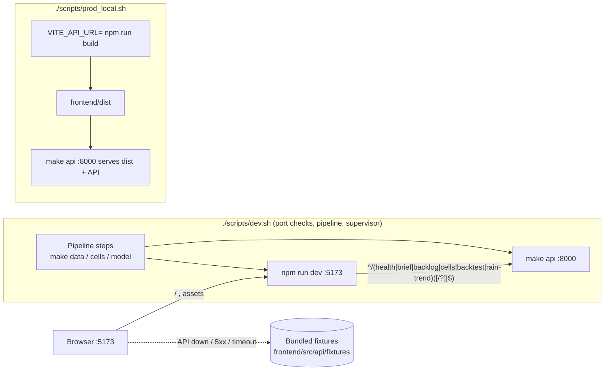

# Design Document: local-dev-macos

## Overview

This design makes DrainFast run locally on macOS with three commands (`./scripts/setup.sh`, `./scripts/dev.sh`, `./scripts/prod_local.sh`). It covers:

- Moving the root Vite app into `frontend/` (Step 0, pending user approval).
- A Vite config with a strict-port dev server, a regex-matched dev proxy to `http://localhost:8000`, and a build-only Pages base path.
- An API client (`frontend/src/api/client.ts`) that resolves its base URL from `VITE_API_URL`, enforces a 10 s timeout, and falls back to bundled fixtures on network errors and 5xx.
- A Demo_Badge driven by a small data-source registry.
- Three bash scripts sharing a helper library, written for macOS's stock bash 3.2.
- A "Run locally" README section.

Grounding facts checked at design time:

- Root `package.json` uses React 19, Vite 8, TypeScript ~6.0, ESLint 10, with `dev: vite` and `build: tsc -b && vite build`. Steering says React 18; the design keeps the versions already declared and does not change them.
- Root `vite.config.ts` only registers `@vitejs/plugin-react`. There is no proxy, port or base config yet.
- `src/App.tsx` is still the Vite template. No `src/api/` exists.
- Root `.gitignore` has `*.local`, `node_modules` and `dist` (unanchored, so they also match inside `frontend/`).
- `backend/`, `model/`, `contracts/fixtures/` and `contracts/openapi.yaml` do not exist. `contracts/schemas.py` defines `BriefResponse`, `BacklogItem`, `Cell`, `BacktestResult` and `RainTrendPoint`, which shape the bundled fixtures.
- The Dockerfile builds `frontend/` with `npm ci && npm run build`, then serves uvicorn on port 8080 with `DRAINFAST_FALLBACK=1` and no `--reload`.
- The Makefile `api` target runs `uvicorn backend.app:app --reload --port 8000`. `web` runs `cd frontend && npm run dev`.

### Resolution of open decisions

| Decision | Resolution |
|---|---|
| (a) Move root app into `frontend/` | Designed as an isolated Step 0 using `git mv`. **Pending user approval** because it deletes root files outside `frontend/`, `scripts/` and `README.md`. Every other step assumes Step 0 is done, either by the agent after approval or by the user by hand. |
| (b) Pages base path | Build-time env var `VITE_BASE_PATH`, normalized to exactly one leading and one trailing `/`. It applies only when `command === 'build'`. Dev always uses `/`. It is not added to `frontend/.env.example`, because Req 4.1 allows only `VITE_API_URL` there; it is documented in a comment in `vite.config.ts`. |
| (c) `prod_local.sh` vs Dockerfile | `prod_local.sh` runs `make api` (port 8000, `--reload`, fallback opt-in). The Dockerfile uses port 8080, defaults to `DRAINFAST_FALLBACK=1` and runs without `--reload`. The README Docker subsection calls out this difference. The Dockerfile is unchanged. |

### Research findings

- Vite `server.proxy` keys that start with `^` are treated as regular expressions. Plain string keys are prefix matches, so `/cells` would also match `/cellsfoo`, which Req 2.1 forbids. Proxy options are passed to the underlying http-proxy, which supports `timeout`/`proxyTimeout` and a `configure(proxy)` hook to handle `error` events ([Vite server options](https://vite.dev/config/server-options.html#server-proxy)).
- `server.strictPort: true` makes Vite exit when the port is busy instead of trying the next port ([Vite server options](https://vite.dev/config/server-options.html#server-strictport)).
- `defineConfig` accepts a function that receives `{ command }`, so `base` can differ between `serve` and `build` ([Vite config](https://vite.dev/config/#conditional-config)).
- Vite gives env vars already present in `process.env` priority over `.env*` files. Setting `VITE_API_URL=` (empty) in the build environment therefore overrides any `frontend/.env.local` value. Unsetting the var would not, because Vite would then read it from the file ([Vite env and mode](https://vite.dev/guide/env-and-mode.html#env-files)).
- macOS ships `/bin/bash` 3.2. That means no `wait -n`, no associative arrays, no `${var,,}` and no `mapfile`. The scripts must stay within 3.2 features.
- `lsof -nP -iTCP:<port> -sTCP:LISTEN -Fpc` prints `p<pid>` and `c<command>` lines for listeners. It is available on stock macOS.
- In a non-interactive bash, `set -m` puts each background job in its own process group, so `kill -TERM -- -<pgid>` stops a job and its children (for example the uvicorn `--reload` worker and Vite's esbuild children).

## Architecture



The scripts share one library, `scripts/lib.sh`. All runtime HTTP from the app goes through `client.ts`. Components read data only through hooks that call the client and report each dataset's source to the badge registry.

### File layout (after this feature)

```
frontend/
  package.json  package-lock.json  index.html  eslint.config.js
  tsconfig.json  tsconfig.app.json  tsconfig.node.json
  vite.config.ts           base, port, strictPort, proxy
  vite.helpers.ts          pure: API_PATHS, API_PATH_PATTERN, isApiPath, normalizeBasePath
  vitest.config.ts
  .env.example
  public/  src/
    api/client.ts          resolveBase, joinUrl, decideOutcome, apiGet
    api/fixtures/index.ts  path -> fixture map
    api/fixtures/*.json    health, brief, backlog, cells, backtest, rain-trend
    data/sources.ts        pure: showDemoBadge(sources)
    data/DataSourceContext.tsx
    components/DemoBadge.tsx
  tests/                   vitest + fast-check (outside tsc -b project includes)
scripts/
  lib.sh  setup.sh  dev.sh  prod_local.sh
  tests/run.sh  tests/stubs/  tests/test_*.sh
README.md                  "Run locally" section
```

`vite.helpers.ts` is added to the `include` of `tsconfig.node.json` so `tsc -b` type-checks it alongside `vite.config.ts`.

## Components and Interfaces

### Step 0: Move the app into `frontend/` (PENDING USER APPROVAL)

This is a single isolated commit that can be dropped, or run by the user:

```bash
git mv package.json package-lock.json index.html vite.config.ts \
       tsconfig.json tsconfig.app.json tsconfig.node.json eslint.config.js \
       public src frontend/
rm -rf node_modules dist      # untracked, gitignored build leftovers
```

No file contents change in this step. Afterwards, `cd frontend && npm ci && npm run build` must pass (Req 1.1–1.4). If approval is withheld, every later step still applies, but it targets files the user moves by hand.

### `frontend/vite.helpers.ts` (pure)

```ts
export const API_PATHS = ['/health', '/brief', '/backlog', '/cells', '/backtest', '/rain-trend'] as const
// Exact path, or prefix followed by '/' or '?'
export const API_PATH_PATTERN = '^/(health|brief|backlog|cells|backtest|rain-trend)(?:[/?]|$)'
export function isApiPath(url: string): boolean        // new RegExp(API_PATH_PATTERN).test(url)
export function normalizeBasePath(raw: string | undefined): string
// undefined / whitespace-only -> '/'; else trim, strip all leading/trailing '/', return `/${core}/`
// (core empty after stripping -> '/')
```

### `frontend/vite.config.ts`

```ts
export default defineConfig(({ command }) => ({
  plugins: [react()],
  base: command === 'build' ? normalizeBasePath(process.env.VITE_BASE_PATH) : '/',
  server: {
    port: 5173,
    strictPort: true,
    proxy: {
      [API_PATH_PATTERN]: {
        target: 'http://localhost:8000',
        changeOrigin: false,      // keep Host and other headers as sent (Req 2.2)
        timeout: 30_000,
        proxyTimeout: 30_000,
        configure: (proxy) => proxy.on('error', (_err, _req, res) => {
          // Write 502 {"detail":"Upstream API unavailable at http://localhost:8000"} if headers not sent
        }),
      },
    },
  },
}))
```

The proxy does not rewrite paths, so the path and query pass through unchanged (Req 2.1, 2.2). The error handler writes a response and never throws, so the dev server keeps running (Req 2.4). `VITE_BASE_PATH` also arrives from `.env*` files through `loadEnv(mode, cwd, 'VITE_')`, merged under `process.env`.

### `frontend/src/api/client.ts`

```ts
export type DataSource = 'api' | 'fixture'
export interface ApiResult<T> { data: T; source: DataSource }
export class ApiError extends Error { kind: 'rejected' | 'unreachable'; status?: number }

export function resolveBase(raw: string | undefined): string   // trimmed, trailing '/' stripped; '' if blank
export function joinUrl(base: string, path: string): string
// base === '' -> '/' + path.replace(/^\/+/, '')
// else         -> base.replace(/\/+$/, '') + '/' + path.replace(/^\/+/, '')

export type Outcome = { kind: 'network-error' } | { kind: 'timeout' } | { kind: 'status'; status: number }
export function decideOutcome(o: Outcome): 'ok' | 'fallback' | 'rejected'
// network-error | timeout | 500..599 -> 'fallback'; 400..499 -> 'rejected'; otherwise 'ok'

export async function apiGet<T>(path: string, opts?: { timeoutMs?: number }): Promise<ApiResult<T>>
```

`apiGet` behavior:

- Builds the URL with `joinUrl(resolveBase(import.meta.env.VITE_API_URL), path)`.
- Uses an `AbortController` timeout (default 10 000 ms).
- Maps the result through `decideOutcome`:
  - `ok`: returns the parsed JSON with `source: 'api'`.
  - `fallback`: looks up `fixtureFor(path)`. Returns it with `source: 'fixture'`, or throws `ApiError('unreachable')` when no fixture exists (Req 3.6).
  - `rejected`: throws `ApiError('rejected', status)` and never reads fixtures (Req 3.5).

Other 1xx/3xx statuses are treated as `ok` only when `response.ok` is true. Any non-2xx status outside 4xx/5xx counts as `fallback`.

### `frontend/src/api/fixtures/index.ts`

```ts
export function fixtureFor(path: string): unknown | undefined
// Matches on the pathname (query stripped) against API_PATHS. Exact or '/'-prefixed sub-path
// → that endpoint's fixture.
```

The fixtures are static JSON shaped after `contracts/schemas.py` (`BriefResponse`, a `BacklogItem[]`, a `Cell[]`, a `BacktestResult[]`, a `RainTrendPoint[]` and `{status: "ok"}`). They contain a few cells near Boston with realistic factor contributions and evidence ticket IDs. When the shared `contracts/fixtures/` lands, the frontend owner can replace these files without changing the client API.

### Demo badge

```ts
// src/data/sources.ts (pure)
export function showDemoBadge(sources: Record<string, DataSource>): boolean  // true iff any value === 'fixture'
```

`DataSourceProvider` holds `Record<datasetKey, DataSource>` in React state. Each data hook calls `report(key, result.source)`. `<DemoBadge/>` renders `<span role="status">demo data</span>` when `showDemoBadge` returns true, so screen readers announce it. It uses a high-contrast style that does not rely on color alone. While no dataset has loaded, the record is empty and the badge is hidden.

### `frontend/.env.example`

```
# Optional. Absolute base URL of the DrainFast API, including scheme.
# Example: VITE_API_URL=http://localhost:8000
# Leave unset or empty to send requests to relative URLs on the page's own origin
# (the Vite dev proxy in development, the same server in production).
# Read at build time: restart `npm run dev` or rebuild after changing it.
# Put local overrides in frontend/.env.local (gitignored).
VITE_API_URL=
```

### `scripts/lib.sh` (sourced, bash 3.2 compatible)

```bash
set -Eeuo pipefail
REPO_ROOT="$(cd "$(dirname "${BASH_SOURCE[0]}")/.." && pwd)"
die()          # print to stderr, exit 1
port_owner()   # $1=port -> prints "PORT <port> busy: <command> (PID <pid>)" lines; returns 0 if busy
require_venv() # .venv/bin/activate must exist, else die "run ./scripts/setup.sh"
```

`port_owner` runs `lsof -nP -iTCP:"$1" -sTCP:LISTEN -Fpc 2>/dev/null || true` and pairs the `p`/`c` lines. Each script sources `lib.sh` and `cd "$REPO_ROOT"` before doing anything else, which satisfies Req 5.8, 6.15 and 7 (paths do not depend on the working directory).

### `scripts/setup.sh`

1. Missing-tool collection: for each of `python3.11` and `node`, if `command -v` fails, append the brew command. If any are missing, print all of them to stderr and exit 1 (Req 5.1–5.3).
2. Venv:
   - If `.venv/` is absent, run `python3.11 -m venv .venv`.
   - If it is present, check that `.venv/bin/python -c 'import sys;print("%d.%d"%sys.version_info[:2])'` prints `3.11`. If not, die with a "venv invalid, remove .venv" message without touching it (Req 5.4, 5.5, 5.10).
3. Check that `requirements.txt` and `frontend/package.json` exist, otherwise fail with the step name (Req 5.9).
4. `step "pip install" .venv/bin/python -m pip install -r requirements.txt`, then `step "npm install" npm --prefix frontend install`. `step` runs the command and, on failure, prints `setup failed at: <name>` to stderr and exits with that command's status.
5. Print `Setup complete.`

The script is idempotent: a second run reuses the venv and pip/npm become no-ops (Req 5.7).

### `scripts/dev.sh`

```
require_venv → source .venv/bin/activate                      (6.1, 6.2)
busy=port_owner 8000 + port_owner 5173 → print all, exit 1     (6.3)
if any of data/demo/{cells.parquet,reports.parquet,flood_area.geojson} missing:  (6.4, 6.5)
  for step in data:data_pipeline/run.py cells:data_pipeline/cells.py model:model/run.py
    module missing → note "skipping make <step> (<module> not found)"; continue  (6.6)
    make <step> || { rc=$?; echo "make <step> failed (exit $rc)"; exit $rc }      (6.7)
else note "using existing demo data"
[ -f frontend/package.json ] || die "frontend not set up"       (6.11, checked before starting API)
set -m
if backend/app.py exists: make api & API_PID=$!  else note "frontend will use demo fixtures"  (6.8, 6.10)
npm --prefix frontend run dev & WEB_PID=$!
trap cleanup INT TERM EXIT
echo "Open http://localhost:5173"                               (6.9)
while alive(API_PID or skipped) && alive(WEB_PID); do sleep 1; done
→ report which exited; exit 1                                   (6.12)
```

`cleanup` runs `kill -TERM -- -$pgid` for each started job. It then polls with `kill -0` for up to 4 s and sends `kill -KILL -- -$pgid` to any group still alive, so the script exits within 5 s and frees both ports (Req 6.13, 10.5). A guard variable stops the INT trap and the EXIT trap from both running cleanup. `DRAINFAST_FALLBACK` passes through by environment inheritance, so no code is needed for Req 6.14. Checking `frontend/package.json` before `make api` means Req 6.11 is never reached with an API already running. The cleanup trap still covers that case.

### `scripts/prod_local.sh`

```
require_venv                                       (7.6)
[ -d frontend ] || die "frontend/ not found"; command -v npm || die "npm not found"   (7.7)
port_owner 8000 → print, exit 1                    (7.4, before build: 7.1)
VITE_API_URL= npm --prefix frontend run build || die "frontend build failed"         (7.1, 7.2)
source .venv/bin/activate
[ "${DRAINFAST_FALLBACK:-}" = "1" ] && export DRAINFAST_FALLBACK=1                    (7.5)
echo "Open http://localhost:8000"; exec make api   (7.3, 7.8)
```

`exec` hands Ctrl+C directly to make/uvicorn, which stop their reloader and worker together, so port 8000 is freed within 5 s (Req 7.8). Setting `VITE_API_URL=` to empty instead of unsetting it is deliberate: it overrides any `.env.local` value (see Research). Serving `frontend/dist` from `backend.app` is backend owner C's responsibility. The script depends on it but does not implement it.

### README "Run locally"

The section has exactly five subsections: Setup, Development, Production-like, Docker and Fallback mode. It also has the four-row troubleshooting table required by Req 9.8. The Docker subsection notes that the container uses port 8080 and turns fallback on by default.

### Script permissions

Each script starts with `#!/usr/bin/env bash` and is committed with `git update-index --chmod=+x` (mode 100755), satisfying Req 8.1–8.3. `set -Eeuo pipefail` in `lib.sh` covers Req 8.4–8.5. Steps whose failure is handled on purpose use `cmd || { … }`.

## Data Models

```ts
type ApiPath = '/health' | '/brief' | '/backlog' | '/cells' | '/backtest' | '/rain-trend'
type DataSource = 'api' | 'fixture'
interface ApiResult<T> { data: T; source: DataSource }
type Outcome = { kind: 'network-error' } | { kind: 'timeout' } | { kind: 'status'; status: number }
type Decision = 'ok' | 'fallback' | 'rejected'
type SourceRegistry = Record<string, DataSource>   // datasetKey -> source
```

The fixture JSON mirrors these Pydantic models (snake_case fields):

| Fixture | Schema |
|---|---|
| `health.json` | `{status: "ok"}` |
| `brief.json` | `BriefResponse` |
| `backlog.json` | `BacklogItem[]` |
| `cells.json` | `Cell[]` |
| `backtest.json` | `BacktestResult[]` |
| `rain-trend.json` | `RainTrendPoint[]` |

The script state uses only plain shell variables: `API_PID`, `WEB_PID`, `CLEANED` and the busy-port message list.

## Correctness Properties

*A property is a characteristic or behavior that should hold true across all valid executions of a system-essentially, a formal statement about what the system should do. Properties serve as the bridge between human-readable specifications and machine-verifiable correctness guarantees.*

Properties apply only to the pure TypeScript logic. Shell scripts, proxy forwarding and README content are covered by example, integration and smoke tests (see Testing Strategy).

### Property 1: Proxy path matching follows the API_Paths rule

For any URL path string `u`, `isApiPath(u)` is true if and only if there exists `p` in `API_PATHS` such that `u === p`, or `u` starts with `p + '/'`, or `u` starts with `p + '?'`. Paths that do not match are therefore served by Vite. Generators bias toward near-misses such as `/healthcheck`, `/cells-x`, `/Cells`, `//cells` and `/backtests`.

**Validates: Requirements 2.1, 2.3**

### Property 2: Base path normalization

For any input string `s`, `normalizeBasePath(s)` returns:

- `/` when `s` is undefined, whitespace-only, or made up only of slashes and whitespace.
- Otherwise, `'/' + core + '/'`, where `core` is `s` trimmed with all leading and trailing `/` removed. The result has exactly one leading and one trailing slash.

In both cases `normalizeBasePath(normalizeBasePath(s)) === normalizeBasePath(s)`.

**Validates: Requirements 2.5, 2.6**

### Property 3: Absolute URL joining has exactly one separator

For any absolute base URL `b` with no trailing slash, any `m ≥ 0` trailing slashes, any `n ≥ 0` leading slashes and any path core `c` with no leading slash, `joinUrl(resolveBase(b + '/'.repeat(m)), '/'.repeat(n) + c) === b + '/' + c`.

**Validates: Requirements 3.1, 3.3**

### Property 4: Blank base yields a same-origin relative URL

For any `raw` that is undefined or whitespace-only, and any path `'/'.repeat(n) + c`, `joinUrl(resolveBase(raw), path) === '/' + c`. The result therefore starts with `/` and contains no scheme or host.

**Validates: Requirements 3.2**

### Property 5: Fallback decision by outcome

For any request path `q` and any outcome `o` (network error, timeout, or HTTP status 100–599), with `fetch` mocked to produce `o`, `apiGet(q)` behaves as follows:

- Status 400–499: rejects with `ApiError` of kind `rejected` and never consults the fixtures.
- Network error, timeout or status 500–599, and `fixtureFor(q)` is defined: resolves to `{ data: fixtureFor(q), source: 'fixture' }`.
- Network error, timeout or status 500–599, and `fixtureFor(q)` is undefined: rejects with `ApiError` of kind `unreachable`.
- Status 2xx: resolves to the mocked body with `source: 'api'`.

**Validates: Requirements 3.4, 3.5, 3.6**

### Property 6: Demo badge iff any fixture-sourced dataset

For any registry `r: Record<string, DataSource>`, `showDemoBadge(r) === Object.values(r).includes('fixture')`.

**Validates: Requirements 3.7, 3.8**

## Error Handling

| Situation | Behavior |
|---|---|
| Port 5173 busy at `npm run dev` | `strictPort` makes Vite exit non-zero with "Port 5173 is already in use". |
| Upstream API down or no response in 30 s | Proxy `error` handler returns 502 `{"detail":"Upstream API unavailable at http://localhost:8000"}`. The dev server keeps serving. |
| Network error, 10 s timeout or 5xx in client | Returns the fixture with `source: 'fixture'`, and the badge appears. Without a fixture, throws `ApiError('unreachable')`; the view shows an inline "API unreachable and no sample data" message instead of a blank screen. |
| 4xx in client | Throws `ApiError('rejected', status)`. The view shows "Request rejected (status)". No fixture is used. |
| Missing `python3.11`/`node` | `setup.sh` prints every missing `brew install …` command to stderr and exits 1 before touching `.venv` or `node_modules`. |
| Invalid `.venv` | `setup.sh` exits 1 with "remove .venv and rerun". `dev.sh`/`prod_local.sh` exit 1 with "run ./scripts/setup.sh". |
| Busy port 8000/5173 in scripts | Prints `port N busy: <command> (PID <pid>)` for each busy port and exits 1 before starting anything. |
| Missing pipeline module or `backend/app.py` | `dev.sh` prints a skip note and continues. |
| Pipeline step fails | Prints `make <step> failed (exit N)` and exits N without starting servers. |
| A server dies while `dev.sh` runs | Prints which one exited, kills the other process group, exits 1. |
| Ctrl+C | Trap sends TERM to process groups, sends KILL after 4 s, exits within 5 s. |
| Unexpected command failure | `set -Eeuo pipefail` stops the script with a non-zero status. |

## Testing Strategy

### Frontend (vitest + fast-check)

- Add `vitest`, `fast-check` and `jsdom` as devDependencies in `frontend/package.json`, pinned to exact versions compatible with Vite 8. Add the scripts `"test": "vitest --run"` and `"test:pbt": "vitest --run tests/properties"`.
- Property tests live in `frontend/tests/properties/*.test.ts`. Each of Properties 1–6 is implemented by a single `fc.assert(fc.property(...), { numRuns: 100 })` test (minimum 100 runs). Each test carries a tag comment, for example: `// Feature: local-dev-macos, Property 3: Absolute URL joining has exactly one separator`.
- Property 5 stubs `globalThis.fetch` with `vi.fn` and uses `vi.useFakeTimers` for the timeout case. It spies on `fixtureFor` to assert that no fixture is read on 4xx.
- Unit and example tests in `frontend/tests/unit/`:
  - The `vite.config.ts` function returns `base: '/'` for `serve` even with `VITE_BASE_PATH` set (2.7), and has `strictPort: true` and `port: 5173` (1.6).
  - Every fixture JSON has the required top-level keys of its schema.
  - `DemoBadge` renders `role="status"` only when `showDemoBadge` returns true.
  - `.env.example` defines only an empty `VITE_API_URL` and contains the required comments (4.1, 4.3–4.5).
- Integration tests (`frontend/tests/integration/proxy.test.ts`) start Vite programmatically with `createServer` on a free port and a stub HTTP upstream. They check that the method, headers, body and query are preserved (2.2), that an unreachable upstream returns 502 and `/` still returns 200 (2.4), and that `/healthcheck` is not forwarded.

### Shell scripts (plain bash harness, no new dependency)

`scripts/tests/run.sh` discovers and runs the `scripts/tests/test_*.sh` files. Each test:

- Creates a temp repo skeleton with `mktemp -d`, copies `scripts/` into it and creates only the files that case needs (`requirements.txt`, `frontend/package.json`, `data/demo/*`, `backend/app.py`, `.venv/bin/{python,activate}`).
- Puts `scripts/tests/stubs/` first on a minimal `PATH`. The stubs (`lsof`, `make`, `npm`, `python3.11`, `node`) log their argv and selected env vars (`VITE_API_URL`, `DRAINFAST_FALLBACK`) to `$STUB_LOG`. Control vars choose their behavior: busy port with a fake PID/command, a given exit code, or long-running (`sleep` loops that record their PID).
- Asserts on exit code, stderr and stdout text, the order of stub calls, files created or left unchanged, and, for `dev.sh`, that every recorded stub PID is gone within 5 s after `kill -INT` of the script.

Coverage:

| Script | Criteria covered |
|---|---|
| `setup.sh` | 5.1–5.10 (including running from a foreign cwd and checking that no files appear there) |
| `dev.sh` | 6.1–6.15 |
| `prod_local.sh` | 7.1–7.8 (including `VITE_API_URL` being empty in the build env while it is set in the parent shell, and the port check happening before the build) |
| All scripts | 8.3–8.5, plus a `git ls-files -s scripts/*.sh` mode check for 8.1 |

A README check (`scripts/tests/test_readme.sh`) asserts the "Run locally" heading, the five subsection headings in order, the required commands and URLs, and the four troubleshooting rows (9.1–9.8).

The tests run with `/bin/bash` (3.2) so macOS compatibility is exercised. The Makefile is out of scope, so they run as `bash scripts/tests/run.sh` and `npm --prefix frontend test` rather than through `make test`.

### Smoke and manual verification (Req 1.2–1.5, 10.x)

A short checklist is run once on a real Mac:

1. `./scripts/setup.sh` exits 0.
2. `./scripts/dev.sh` then makes `curl -sf localhost:5173` succeed within 60 s, and the page shows fixture data with the badge while `backend/app.py` is absent.
3. Once the backend exists, the badge hides.
4. Ctrl+C frees ports 5173 and 8000 within 10 s, checked with `lsof`.

If step 1 fails, the run is recorded as failed and `dev.sh` is not run.
