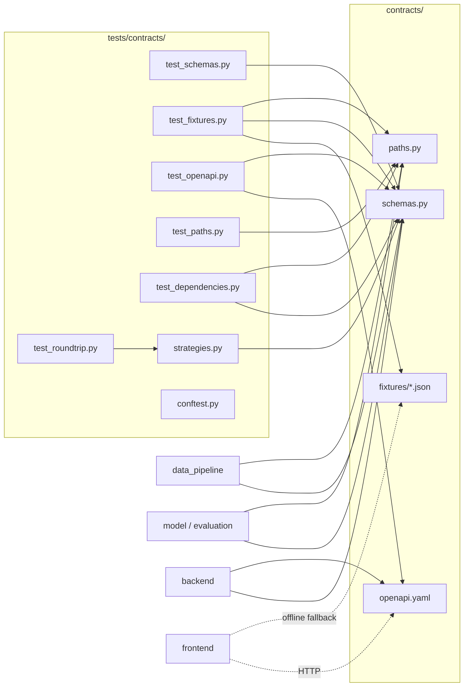

# Design Document: shared-contracts

## Overview

The shared contracts are the frozen, single source of truth for DrainFast data shapes, file paths and HTTP endpoints. Every other module (data_pipeline, model, evaluation, backend, frontend) imports from `contracts.schemas` and `contracts.paths` or consumes `contracts/openapi.yaml` and `contracts/fixtures/`, and never redefines them (tech.md hard rule 5).

Deliverables, all inside `contracts/` and `tests/contracts/` (Requirement 16.1):

| File | Purpose |
|---|---|
| `contracts/__init__.py` | Marks the package; empty (no re-exports, no side effects) |
| `contracts/schemas.py` | 6 enums and 10 Pydantic v2 models with validators |
| `contracts/paths.py` | `pathlib.Path` constants computed from `__file__` |
| `contracts/openapi.yaml` | Hand-written OpenAPI 3.1.0 document, 9 operations |
| `contracts/fixtures/*.json` | 10 files, 3 to 5 synthetic Boston instances each |
| `contracts/requirements.txt` | Pinned runtime and test dependencies |
| `tests/contracts/*.py` | pytest + Hypothesis contract tests |

Key design decisions:

- **Validation lives in the types.** Reusable `Annotated` aliases (`NonBlankStr`, `Latitude`, `Longitude`, `Rate`, ...) carry field constraints; cross-field rules use `@model_validator(mode="after")`. This keeps each model short and makes the constraints visible in `model_json_schema()`, which the OpenAPI test compares against.
- **Strict shape, lax scalars.** Every model sets `extra="forbid"` (Requirement 11.4). Pydantic's default lax mode is kept for scalars so JSON strings parse into `date`, `datetime` and enums; enum matching is already exact and case-sensitive in Pydantic v2.
- **Blank strings are rejected, not stripped.** Stripping would change values and break the round-trip property, so validators check `value.strip()` but return the original string.
- **Hand-written OpenAPI, checked by tests.** The YAML is written by hand for readability and frontend use, then a test compares every component schema against the Pydantic model's JSON schema so the two cannot drift.
- **Models are not frozen.** Backend code builds and updates WorkOrder status; immutability would add friction with no contract benefit. "Frozen" refers to the files, which change only via a `contract:` pull request (structure.md).

## Architecture



Dependency direction follows structure.md: `contracts` imports nothing from the project. `schemas.py` imports only `datetime`, `enum`, `typing`, `math` and `pydantic`; `paths.py` imports only `pathlib` (Requirements 16.2, 16.6).

## Components and Interfaces

### contracts/schemas.py

Shared base class:

```python
class ContractModel(BaseModel):
    model_config = ConfigDict(extra="forbid")
```

Reusable annotated types:

| Alias | Definition | Used by |
|---|---|---|
| `NonBlankStr` | `Annotated[str, AfterValidator(_not_blank)]`; `_not_blank` raises `ValueError` when `s.strip() == ""`, returns `s` unchanged | ids, neighborhood, reason, department |
| `Latitude` | `Annotated[float, Field(ge=-90.0, le=90.0, allow_inf_nan=False)]` | Report, Location, BriefItem |
| `Longitude` | `Annotated[float, Field(ge=-180.0, le=180.0, allow_inf_nan=False)]` | Report, Location, BriefItem |
| `Rate` | `Annotated[float, Field(ge=0.0, le=1.0, allow_inf_nan=False)]` | BriefItem.risk_score, BacktestResult |
| `RainInches` | `Annotated[float, Field(ge=0.0, le=30.0, allow_inf_nan=False)]` | Storm |
| `NonNegFloat` | `Annotated[float, Field(ge=0.0, allow_inf_nan=False)]` | Location.tree_density, NeighborhoodEquity.median_hours_to_close |
| `TicketIdList` | `Annotated[list[NonBlankStr], Field(min_length=1)]` | evidence and ticket lists |

Enums (`class X(str, Enum)`), Requirement 1:

| Enum | Values |
|---|---|
| `CauseLabel` | `clogged_basin`, `grading_capacity`, `coastal_tide`, `unclear` |
| `LabelSource` | `rule`, `llm` |
| `ReportStatus` | `open`, `closed` |
| `WorkOrderStatus` | `pending_approval`, `approved`, `rejected` |
| `Priority` | `high`, `medium`, `low` |
| `GridOrBasin` | `grid`, `basin` |

Pydantic v2 validates `str` enums by exact value match, so `"Open"`, `""`, `1` and `None` (on non-optional fields) all raise `ValidationError` with the field name in `loc` (Requirements 1.7 to 1.10). `model_dump(mode="json")` and `model_dump_json()` emit the plain value (1.11).

Public interface: the 6 enums, the 10 models listed in Data Models, and `ALL_MODELS: tuple[type[ContractModel], ...]` and `ALL_ENUMS: tuple[type[Enum], ...]`, used by tests to iterate without hard-coding lists twice.

### contracts/paths.py

```python
PROJECT_ROOT: Path = Path(__file__).resolve().parent.parent
RAW_DIR = PROJECT_ROOT / "data" / "raw"
PROCESSED_DIR = PROJECT_ROOT / "data" / "processed"
DEMO_DIR = PROJECT_ROOT / "data" / "demo"
REPORTS_PATH = PROCESSED_DIR / "reports.parquet"
LOCATIONS_PATH = PROCESSED_DIR / "locations.parquet"
STORMS_PATH = PROCESSED_DIR / "storms.parquet"
DUPLICATE_PAIRS_PATH = PROCESSED_DIR / "duplicate_pairs.parquet"
FIXTURES_DIR = PROJECT_ROOT / "contracts" / "fixtures"
```

`Path.resolve()` makes the root absolute and symlink-resolved and depends only on `__file__`, not the working directory (12.1, 12.6). Pure path arithmetic means no filesystem access and no failure when the directories are missing (12.5, 12.8). `resolve()` with default `strict=False` does not require existence.

### contracts/openapi.yaml

- `openapi: 3.1.0`, `info` (title DrainFast API, version 1.0.0), one local `servers` entry.
- `components.schemas`: one schema per model and enum, plus `ErrorResponse {detail: string, required}`. Enums use `type: string` + `enum: [...]`. Models use `type: object`, `additionalProperties: false`, `properties`, `required`. Optional fields use `type: [<type>, "null"]` (3.1 style). Dates are `format: date`, datetimes `format: date-time` (13.13). Numeric bounds mirror the Pydantic constraints.
- Operations (exactly 9, Requirement 13.17):

| Method | Path | Params / body | 200 schema | Error refs |
|---|---|---|---|---|
| GET | `/brief` | `date` (date, req), `forecast_rain_in` (number, min 0, req), `top_n` (integer, min 1, opt) | array of BriefItem | 422 |
| GET | `/queue` | none | array of Report | none |
| GET | `/locations/{location_id}/history` | `location_id` string | array of Report | 404, 422 |
| GET | `/storms/{storm_day}/summary` | `storm_day` date | StormSummary | 404, 422 |
| GET | `/backtest` | none | array of BacktestResult | none |
| GET | `/equity` | none | array of NeighborhoodEquity | none |
| POST | `/replay/{storm_day}` | `storm_day` date | StormSummary | 404, 422 |
| POST | `/workorders/{work_order_id}/approve` | `work_order_id` string | WorkOrder | 404, 422 |
| POST | `/copilot/chat` | body CopilotRequest (required) | CopilotResponse | 422 |

Each 200 response uses `application/json` with a `$ref` or array of `$ref` (13.16). Each 404/422 response references `#/components/schemas/ErrorResponse` (13.14, 13.15). Every operation gets an `operationId` (snake_case, for example `get_brief`) so FastAPI and frontend client generation line up.

`StormSummary.counts_by_cause` is an object with the four CauseLabel keys as required properties of type integer, minimum 0, `additionalProperties: false`, matching the Pydantic rule that all keys are present.

### contracts/fixtures/

Ten JSON files, each a top-level array of 3 to 5 objects in `model_dump(mode="json")` form. File name is the snake_case model name. A mapping `FIXTURE_FILES: dict[str, type[ContractModel]]` lives in the test helpers (not in `contracts/`), so `contracts/` stays free of test code.

### contracts/requirements.txt

```
pydantic==2.9.2
pytest==8.3.3
hypothesis==6.112.1
PyYAML==6.0.2
openapi-spec-validator==0.7.1
```

Only packages imported directly by `contracts/` or `tests/contracts/` (16.3, 16.5). The root `requirements.txt` (owned by C) includes it with `-r contracts/requirements.txt`; that change is requested from owner C, not made here.

## Data Models

All models subclass `ContractModel` (`extra="forbid"`). "req" means no default. Cross-field rules are `model_validator(mode="after")` that raise `ValueError` with a message naming the fields involved.

### Report (Requirement 2)

| Field | Type | Default |
|---|---|---|
| `ticket_id` | NonBlankStr | req |
| `opened_at` | AwareDatetime | req |
| `closed_at` | AwareDatetime \| None | None |
| `status` | ReportStatus | req |
| `lat` / `lon` | Latitude / Longitude | req |
| `location_id` | NonBlankStr | req |
| `text` | str | req |
| `closing_note` | str \| None | None |
| `cause_label` | CauseLabel | req |
| `label_source` | LabelSource | req |
| `storm_day` | date \| None | None |
| `neighborhood` | NonBlankStr | req |
| `ej_flag` | bool | req |
| `duplicate_of` | str \| None | None |

Model validators: `closed_at >= opened_at` when present (equal accepted, 2.3, 2.7); `status == open` implies `closed_at is None` (2.9); `duplicate_of != ticket_id` (2.5). `AwareDatetime` rejects naive datetimes (2.2). `text` may be empty because some 311 tickets have no description.

### Location (Requirement 3)

`location_id` NonBlankStr, `lat` Latitude, `lon` Longitude, `grid_or_basin` GridOrBasin, `tree_density` NonNegFloat (0.0 accepted), `coastal_flag` bool, `ej_flag` bool, `neighborhood` NonBlankStr. All required.

### Storm (Requirement 4)

`storm_day` date, `rain_total_in` RainInches, `max_hourly_in` RainInches, `high_tide_flag` bool. All required. Validator: `max_hourly_in <= rain_total_in`. Pydantic v2 lax `date` accepts `"YYYY-MM-DD"` and rejects datetimes with a non-zero time (`date_from_datetime_inexact`), covering 4.6 and 4.7.

### BriefItem (Requirement 5)

`rank` `int` `ge=1`, `location_id` NonBlankStr, `lat` Latitude, `lon` Longitude, `risk_score` Rate, `reason` NonBlankStr, `evidence_ticket_ids` TicketIdList. All required. Lists keep input order (5.9).

### WorkOrder (Requirement 6)

`work_order_id` NonBlankStr, `ticket_ids` TicketIdList, `location_id` NonBlankStr, `cause_label` CauseLabel, `department` NonBlankStr, `priority` Priority, `history_summary` str, `evidence_ticket_ids` TicketIdList, `status` WorkOrderStatus = `WorkOrderStatus.pending_approval`.

### StormSummary (Requirement 7)

`storm_day` date, `report_count` `int ge=0`, `counts_by_cause` `dict[CauseLabel, Annotated[int, Field(ge=0)]]`, `duplicates_merged` `int ge=0`, `repeat_location_ids` `list[NonBlankStr]` (may be empty). Validators: key set equals `set(CauseLabel)` (7.8); `sum(counts_by_cause.values()) == report_count` (7.3); `duplicates_merged <= report_count` (7.4); `repeat_location_ids` has no duplicates (7.9). Unknown keys fail enum key validation before the after-validator.

### BacktestResult (Requirement 8)

`storm_day` date and six Rate fields: `hit_rate_top100`, `hit_rate_top200`, `random_top100`, `random_top200`, `most_complaints_top100`, `most_complaints_top200`. Validator checks each method in `("hit_rate", "random", "most_complaints")` and raises `ValueError(f"{method}: top100 ({a}) > top200 ({b})")` when `top100 > top200`, so the message names the ranking method (8.3).

### NeighborhoodEquity (Requirement 9)

`neighborhood` `Annotated[NonBlankStr, Field(min_length=1, max_length=100)]`, `total_reports` `int ge=0`, `open_cases` `int ge=0`, `median_hours_to_close` `NonNegFloat | None = None`, `high_risk_low_reports` bool. Validators: `open_cases <= total_reports`; when `open_cases == total_reports` (no closed cases, including 0 == 0) `median_hours_to_close` must be None (9.5).

### CopilotRequest / CopilotResponse (Requirement 10)

- `CopilotRequest.message`: `Annotated[NonBlankStr, Field(min_length=1, max_length=2000)]`.
- `CopilotResponse`: `answer` str (req), `tools_used` `list[str]` `Field(default_factory=list, max_length=20)`, `fallback_mode` bool (req). With `extra="forbid"` and no aliases, the dump has exactly three keys (10.5).

### Serialization (Requirement 11)

No aliases anywhere, so JSON keys equal field names (11.1). `model_dump_json()` writes enums as values, `date` as `YYYY-MM-DD`, aware datetimes as ISO 8601 with offset (11.2), and None as `null` (11.5; no `exclude_none`). Round-trip equality holds because aware datetimes compare by instant and Pydantic's float output is the shortest exact representation.

## Correctness Properties

*A property is a characteristic or behavior that should hold true across all valid executions of a system-essentially, a formal statement about what the system should do. Properties serve as the bridge between human-readable specifications and machine-verifiable correctness guarantees.*

PLACEHOLDER_PROPERTIES

## Error Handling

- All validation failures raise `pydantic.ValidationError`. Field-level constraints place the field name in `errors()[i]["loc"]` (1.7, 1.9, 1.10, 2.11, 6.7). Cross-field validators raise `ValueError`, which Pydantic wraps; the message names the fields or ranking method.
- Malformed JSON passed to `model_validate_json` raises `ValidationError` with type `json_invalid` (11.6).
- `paths.py` cannot fail at import: it performs no I/O.
- Fixture test failures use messages of the form `"{file}[{index}]: {error}"` (15.10).
- The backend (owner C) maps `ValidationError` to HTTP 422 with `ErrorResponse`; that behavior is declared in the OpenAPI document but implemented outside this spec.

## Testing Strategy

PBT applies: the schemas are pure validation and serialization logic with large input spaces. Library: **Hypothesis** (already in tech.md). Each property is implemented by exactly one Hypothesis test with `@settings(max_examples=100)` or more, tagged with a comment:

```python
# Feature: shared-contracts, Property 1: Serialization round trip
```

### Test files

| File | Contents |
|---|---|
| `conftest.py` | Inserts `PROJECT_ROOT` into `sys.path`; sets `DRAINFAST_FALLBACK=1`; autouse fixture patching `socket.socket.connect` to raise, so any network use fails (15.9) |
| `strategies.py` | Hypothesis strategies: one `valid_<model>()` builder per model, built with `st.builds` plus constrained field strategies so cross-field rules hold (e.g. `closed_at = opened_at + timedelta`, `counts_by_cause` drawn then `report_count = sum`) |
| `test_schemas.py` | Example and edge-case unit tests: enum value sets, required fields, defaults, boundary values (0.0, 1.0, equal timestamps, equal top100/top200, empty repeat list), BriefItem empty evidence (15.3), WorkOrder default status (15.4) |
| `test_roundtrip.py` | Property tests 1 to 9 below |
| `test_fixtures.py` | All 10 files present (15.2), 3 to 5 instances (15.11), each validates (15.1, 15.10), uniqueness, cross-file references (15.8), coverage of every CauseLabel, an open report, a duplicate, Boston bounds, at least 3 neighborhoods, no emails or phone patterns |
| `test_openapi.py` | `openapi_spec_validator.validate` on the parsed YAML (15.5); component names cover `ALL_MODELS` and `ALL_ENUMS` (15.6); per model, property names, required set, enum values and type/format match `model_json_schema()`; exactly the 9 operations with the listed params, 200 `$ref`s and 404/422 `ErrorResponse` refs |
| `test_paths.py` | Constants are absolute `Path`s at the expected locations; reports/locations/storms/pairs have parent `PROCESSED_DIR`; import from a temp cwd via `subprocess` gives the same `PROJECT_ROOT`; import does not create missing dirs |
| `test_dependencies.py` | AST scan of every `.py` in `contracts/` and `tests/contracts/` (including function-local imports) against the allowed top-level module list (16.2, 16.4, 16.6); every pin in `requirements.txt` uses `==` and every listed package is imported (16.3, 16.5) |

### Balance

Unit tests cover specific examples, boundaries and the OpenAPI/fixture/path checks, which are deterministic. Property tests cover the validation rules over generated inputs, where Hypothesis finds edge cases (whitespace variants, NaN, extreme floats, timezone offsets) better than hand-picked examples.

### make test

`make test` (Makefile owned by C) runs `pytest`; pytest exits non-zero on any failure, satisfying 15.12. If the Makefile does not yet include `tests/contracts`, that addition is requested from owner C.
