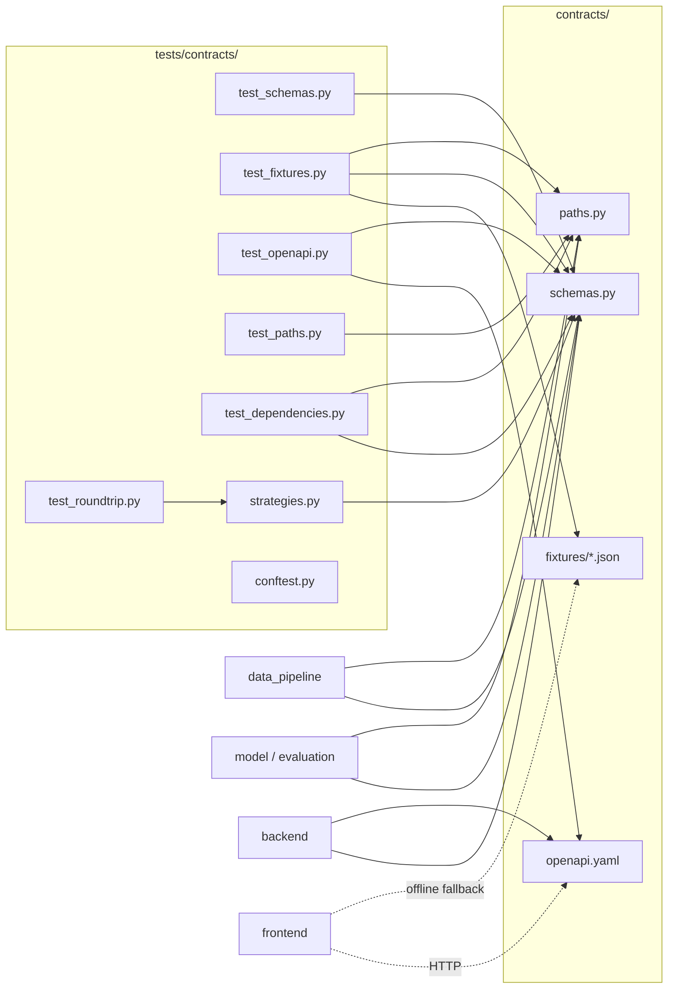

# Design Document: shared-contracts

## Overview

The shared contracts are the frozen, single source of truth for DrainFast data shapes, file paths and HTTP endpoints. Every other module (data_pipeline, model, evaluation, backend, frontend) imports from `contracts.schemas` and `contracts.paths` or consumes `contracts/openapi.yaml` and `contracts/fixtures/`, and never redefines them (tech.md hard rule 5).

Deliverables, all inside `contracts/` and `tests/contracts/` (Requirement 16.1):

| File | Purpose |
|---|---|
| `contracts/__init__.py` | Marks the package; empty (no re-exports, no side effects) |
| `contracts/schemas.py` | 4 enums, 9 Pydantic v2 models with validators, 3 constants |
| `contracts/paths.py` | `pathlib.Path` constants computed from `__file__` |
| `contracts/openapi.yaml` | Hand-written OpenAPI 3.1.0 document, 6 operations |
| `contracts/fixtures/*.json` | 9 files, 3 to 5 synthetic Boston instances each |
| `contracts/requirements.txt` | Pinned runtime and test dependencies |
| `tests/contracts/*.py` | pytest + Hypothesis contract tests |

Key design decisions:

- **Validation lives in the types.** Reusable `Annotated` aliases (`NonBlankStr`, `Latitude`, `Longitude`, `Rate`, ...) carry field constraints; cross-field rules use `@model_validator(mode="after")`. This keeps each model short and makes the constraints visible in `model_json_schema()`, which the OpenAPI test compares against.
- **Strict shape, lax scalars.** Every model sets `extra="forbid"` (Requirement 11.4). Pydantic's default lax mode is kept for scalars so JSON strings parse into `date`, `datetime` and enums; enum matching is already exact and case-sensitive in Pydantic v2.
- **Blank strings are rejected, not stripped.** Stripping would change values and break the round-trip property, so validators check `value.strip()` but return the original string.
- **Hand-written OpenAPI, checked by tests.** The YAML is written by hand for readability and frontend use, then a test compares every component schema against the Pydantic model's JSON schema so the two cannot drift.
- **Scores carry their breakdown.** `priority_score` on BriefItem and BacklogItem must equal the sum of `factors[].contribution` within `FACTOR_SUM_TOLERANCE` (tech.md hard rule 10), so every ranked score is explainable from its parts.
- **Models are not frozen.** Builders in the pipeline, model and backend construct instances incrementally; immutability would add friction with no contract benefit. "Frozen" refers to the files, which change only via a `contract:` pull request (structure.md).
- **V1 scope.** Location, WorkOrder, StormSummary, NeighborhoodEquity, CopilotRequest, CopilotResponse and the WorkOrderStatus, Priority and GridOrBasin enums are removed for V1 and return in V2/V3.

## Architecture



Dependency direction follows structure.md: `contracts` imports nothing from the project. `schemas.py` imports only `datetime`, `enum`, `typing`, `math` and `pydantic`; `paths.py` imports only `pathlib` (Requirements 16.2, 16.6).

## Components and Interfaces

### contracts/schemas.py

Shared base class:

```python
class ContractModel(BaseModel):
    model_config = ConfigDict(extra="forbid")
```

Reusable annotated types:

| Alias | Definition | Used by |
|---|---|---|
| `NonBlankStr` | `Annotated[str, AfterValidator(_not_blank)]`; `_not_blank` raises `ValueError` when `s.strip() == ""`, returns `s` unchanged | ids, neighborhood, reason, factor, status_label |
| `Latitude` | `Annotated[float, Field(ge=-90.0, le=90.0, allow_inf_nan=False)]` | Report, Cell, BriefItem |
| `Longitude` | `Annotated[float, Field(ge=-180.0, le=180.0, allow_inf_nan=False)]` | Report, Cell, BriefItem |
| `Rate` | `Annotated[float, Field(ge=0.0, le=1.0, allow_inf_nan=False)]` | BacktestResult |
| `RainInches` | `Annotated[float, Field(ge=0.0, le=30.0, allow_inf_nan=False)]` | Storm |
| `NonNegFloat` | `Annotated[float, Field(ge=0.0, allow_inf_nan=False)]` | Cell.tree_density, BacklogItem.age_days, BriefResponse.forecast_rain_in |
| `FiniteFloat` | `Annotated[float, Field(allow_inf_nan=False)]` | FactorContribution.value, FactorContribution.contribution, priority_score |
| `TicketIdList` | `Annotated[list[NonBlankStr], Field(min_length=1)]` | evidence_ticket_ids |

Module constants:

```python
STORM_DAY_THRESHOLD_IN: float = 1.0
STATUS_UNCLEAR: str = "Status unclear"
FACTOR_SUM_TOLERANCE: float = 1e-6
```

`Storm.is_storm_day(threshold: float = STORM_DAY_THRESHOLD_IN) -> bool` returns `rain_total_in >= threshold`.

Shared helper `_check_factor_sum(priority_score: float, factors: list[FactorContribution]) -> None` raises `ValueError` when `abs(priority_score - sum(f.contribution for f in factors)) > FACTOR_SUM_TOLERANCE`. BriefItem and BacklogItem call it from their `@model_validator(mode="after")`.

Enums (`class X(str, Enum)`), Requirement 1:

| Enum | Values |
|---|---|
| `CauseLabel` | `clogged_basin`, `grading_capacity`, `coastal_tide`, `unclear` |
| `LabelSource` | `rule`, `llm` |
| `ReportStatus` | `open`, `closed` |
| `BasinOwner` | `BWSC`, `City`, `Private`, `Mixed`, `Unknown` |

Pydantic v2 validates `str` enums by exact value match, so `"Open"`, `""`, `1` and `None` (on non-optional fields) all raise `ValidationError` with the field name in `loc` (Requirements 1.7 to 1.10). `model_dump(mode="json")` and `model_dump_json()` emit the plain value (1.11).

Public interface: the 4 enums, the 9 models listed in Data Models (Report, Cell, Storm, FactorContribution, BriefItem, BriefResponse, BacklogItem, BacktestResult, RainTrendPoint), the 3 constants, and `ALL_MODELS: tuple[type[ContractModel], ...]` and `ALL_ENUMS: tuple[type[Enum], ...]`, used by tests to iterate without hard-coding lists twice.

### contracts/paths.py

```python
PROJECT_ROOT: Path = Path(__file__).resolve().parent.parent
RAW_DIR = PROJECT_ROOT / "data" / "raw"
PROCESSED_DIR = PROJECT_ROOT / "data" / "processed"
DEMO_DIR = PROJECT_ROOT / "data" / "demo"
REPORTS_PATH = PROCESSED_DIR / "reports.parquet"
CELLS_PATH = PROCESSED_DIR / "cells.parquet"
STORMS_PATH = PROCESSED_DIR / "storms.parquet"
DUPLICATE_PAIRS_PATH = PROCESSED_DIR / "duplicate_pairs.parquet"
BASINS_PATH = PROCESSED_DIR / "basins.parquet"
FLOOD_AREAS_PATH = PROCESSED_DIR / "flood_areas.parquet"
RAIN_TREND_PATH = PROCESSED_DIR / "rain_trend.parquet"
FIXTURES_DIR = PROJECT_ROOT / "contracts" / "fixtures"
```

`Path.resolve()` makes the root absolute and symlink-resolved and depends only on `__file__`, not the working directory (12.1, 12.6). Pure path arithmetic means no filesystem access and no failure when the directories are missing (12.5, 12.8). `resolve()` with default `strict=False` does not require existence.

### contracts/openapi.yaml

- `openapi: 3.1.0`, `info` (title DrainFast API, version 1.0.0), one local `servers` entry.
- `components.schemas`: one schema per model (9) and enum (4), plus `HealthResponse {status: string, fallback: boolean, both required}` and `ErrorResponse {detail: string, required}`. Enums use `type: string` + `enum: [...]`. Models use `type: object`, `additionalProperties: false`, `properties`, `required`. Optional fields use `type: [<type>, "null"]` (3.1 style). Dates are `format: date`, datetimes `format: date-time` (13.13). Numeric bounds mirror the Pydantic constraints.
- Operations (exactly 6, Requirement 13.15):

| Method | Path | Params | 200 schema | Error refs |
|---|---|---|---|---|
| GET | `/health` | none | HealthResponse | none |
| GET | `/brief` | `date` (date, req), `crews` (integer, min 1, req), `capacity_per_crew` (integer, min 1, default 30, opt) | BriefResponse | 422 |
| GET | `/backlog` | `limit` (integer, min 1, opt) | array of BacklogItem | 422 |
| GET | `/cells/{cell_id}/history` | `cell_id` string | array of Report | 404, 422 |
| GET | `/backtest` | none | array of BacktestResult | none |
| GET | `/rain-trend` | none | array of RainTrendPoint | none |

Each 200 response uses `application/json` with a `$ref` or array of `$ref` (13.14). Each 404/422 response references `#/components/schemas/ErrorResponse` (13.12, 13.13). Every `$ref` points into `#/components/schemas` and resolves (13.16). Every operation gets an `operationId` (snake_case, for example `get_brief`) so FastAPI and frontend client generation line up.

### contracts/fixtures/

Nine JSON files (`report`, `cell`, `storm`, `factor_contribution`, `brief_item`, `brief_response`, `backlog_item`, `backtest_result`, `rain_trend_point`, each `.json`), each a top-level array of 3 to 5 objects in `model_dump(mode="json")` form. File name is the snake_case model name. A mapping `FIXTURE_FILES: dict[str, type[ContractModel]]` lives in the test helpers (not in `contracts/`), so `contracts/` stays free of test code.

### contracts/requirements.txt

```
pydantic==2.9.2
pytest==8.3.3
hypothesis==6.112.1
PyYAML==6.0.2
openapi-spec-validator==0.7.1
```

Only packages imported directly by `contracts/` or `tests/contracts/` (16.3, 16.5). The root `requirements.txt` (owned by C) includes it with `-r contracts/requirements.txt`; that change is requested from owner C, not made here.


## Data Models
All models subclass `ContractModel` (`extra="forbid"`). "req" = no default. Cross-field rules are `model_validator(mode="after")` raising `ValueError` naming the fields.
### Report (Requirement 2)
| Field | Type | Default |
|---|---|---|
| ticket_id | NonBlankStr | req |
| opened_at | AwareDatetime | req |
| closed_at | AwareDatetime \| None | None |
| status | ReportStatus | req |
| lat | Latitude | req |
| lon | Longitude | req |
| cell_id | NonBlankStr | req |
| text | str | req |
| closing_note | str \| None | None |
| note_blank | bool | req |
| cause_label | CauseLabel | req |
| label_source | LabelSource | req |
| storm_day | date \| None | None |
| neighborhood | NonBlankStr | req |
| ej_flag | bool | req |
| duplicate_of | str \| None | None |

Validators: `closed_at >= opened_at` when set (2.3, 2.7); status open implies `closed_at is None` (2.9); `duplicate_of != ticket_id` (2.5).
### Cell (Requirement 3)
`cell_id: NonBlankStr`, `lat: Latitude`, `lon: Longitude`, `neighborhood: NonBlankStr`, `basin_count: int (ge=0)`, `basin_owner: BasinOwner`, `ej_flag: bool`, `flood_area_flag: bool`, `tree_density: NonNegFloat | None = None`.
### Storm (Requirement 4)
`storm_day: date`, `rain_total_in: RainInches`, `max_hourly_in: RainInches`, `high_tide_flag: bool`. Validator: `max_hourly_in <= rain_total_in`. Method `is_storm_day(threshold: float = STORM_DAY_THRESHOLD_IN) -> bool` returns `rain_total_in >= threshold` (4.8-4.11).
### FactorContribution (Requirement 5)
`factor: NonBlankStr`, `value: FiniteFloat`, `contribution: FiniteFloat`; all req. Negative and zero contributions are allowed.
### BriefItem (Requirement 6)
`rank: int (ge=1)`, `cell_id: NonBlankStr`, `lat: Latitude`, `lon: Longitude`, `priority_score: FiniteFloat`, `factors: list[FactorContribution] (min_length=1)`, `reason: NonBlankStr`, `evidence_ticket_ids: TicketIdList`. Validator: `_check_factor_sum` (6.8, 6.9). Lists keep their input order (6.11).
### BriefResponse (Requirement 7)
`date: date`, `forecast_rain_in: NonNegFloat`, `high_tide_flag: bool`, `crews: int (ge=1)`, `capacity_per_crew: int (ge=1) = 30`, `items: list[BriefItem]` (may be empty), `fallback_mode: bool`. Validators: `len(items) <= crews * capacity_per_crew` (7.6, 7.7); `[i.rank for i in items] == list(range(1, len(items) + 1))` (7.8).
### BacklogItem (Requirement 8)
`ticket_id: NonBlankStr`, `cell_id: NonBlankStr`, `opened_at: AwareDatetime`, `age_days: NonNegFloat`, `cause_label: CauseLabel`, `note_blank: bool`, `status_label: NonBlankStr`, `priority_score: FiniteFloat`, `factors: list[FactorContribution] (min_length=1)`, `evidence_ticket_ids: TicketIdList`; all req. Validators: `_check_factor_sum` (8.8); `note_blank` implies `status_label == STATUS_UNCLEAR` (8.10, 8.11).
### BacktestResult (Requirement 9)
`storm_day: date`, `n_fixable_reports: int (ge=0)`, `n_cells: int (ge=1)`, plus six `Rate` fields (top-100 and top-200 for each method). Validator: for each method in `("hit_rate", "random", "most_complaints")`, raises `ValueError(f"{method}: top100 ({a}) > top200 ({b})")` when top-100 exceeds top-200 (9.4).
### RainTrendPoint (Requirement 10)
`year: int (ge=1900, le=2100)`, `heavy_rain_days: int (ge=0, le=366)`.
### Serialization (Requirement 11)
No aliases; JSON keys equal field names. Enums serialize as their values, `date` as `YYYY-MM-DD`, aware datetimes as ISO 8601 with offset, and `None` as `null`. The round trip holds because aware datetimes compare by instant and Pydantic serializes floats with the shortest exact representation.

## Correctness Properties

*A property is a characteristic or behavior that should hold true across all valid executions of a system-essentially, a formal statement about what the system should do. Properties serve as the bridge between human-readable specifications and machine-verifiable correctness guarantees.*

### Property 1: Serialization round trip

*For all* valid instances `x` of any Model, `type(x).model_validate_json(x.model_dump_json()) == x`, the JSON keys equal the field names, and `None` fields serialize as `null`.

**Validates: Requirements 11.1, 11.2, 11.3, 11.5, 15.12**

### Property 2: Enum fields accept exactly enum values

*For all* enum-typed fields and all candidate strings, validation succeeds iff the string is one of the enum's values.

**Validates: Requirements 1.5, 1.6, 1.7, 1.8, 1.9**

### Property 3: Unknown fields rejected

*For all* valid Model payloads extended with a key that is not a declared field, validation raises a `ValidationError`.

**Validates: Requirements 11.4**

### Property 4: Blank strings rejected in NonBlankStr fields

*For all* NonBlankStr fields and all Blank_Strings (empty or whitespace-only), validation raises a `ValidationError`.

**Validates: Requirements 2.10, 3.3, 5.3, 6.4, 8.4**

### Property 5: Float bounds and finiteness

*For all* bounded float fields, NaN, ±infinity, and values outside the bounds are rejected, while values within the bounds, including the inclusive endpoints, are accepted.

**Validates: Requirements 2.4, 2.8, 3.4, 3.5, 3.7, 3.8, 4.2, 5.4, 6.5, 6.6, 8.6, 9.3, 9.5, 9.7**

### Property 6: Report consistency

*For all* Report payloads, validation is rejected when any datetime is naive, when `closed_at` precedes `opened_at`, when status is open while `closed_at` is set, or when `duplicate_of` equals the report's own id, and accepted otherwise.

**Validates: Requirements 2.2, 2.3, 2.5, 2.7, 2.9**

### Property 7: Storm ordering and is_storm_day

*For all* storm records, validation is accepted iff `max_hourly_in <= rain_total_in`, and *for all* thresholds `t`, `is_storm_day(t) == (rain_total_in >= t)`.

**Validates: Requirements 4.3, 4.5, 4.10, 4.11**

### Property 8: Evidence rule

*For all* BriefItem and BacklogItem payloads, validation is accepted iff `evidence_ticket_ids` is non-empty and contains no Blank_String, and accepted instances preserve the given order of `evidence_ticket_ids`.

**Validates: Requirements 6.10, 6.11, 8.9, 15.3, 15.4, 15.10**

### Property 9: Status unclear rule

*For all* BacklogItem payloads with `note_blank` true, validation is accepted iff `status_label == STATUS_UNCLEAR`.

**Validates: Requirements 8.10, 8.11, 15.5, 15.11**

### Property 10: Factor sum

*For all* BriefItem and BacklogItem payloads, validation is accepted iff `factors` is non-empty and `|priority_score - sum(f.contribution for f in factors)| <= 1e-6`.

**Validates: Requirements 6.7, 6.8, 6.9, 8.7, 8.8**

### Property 11: BriefResponse capacity and rank sequence

*For all* BriefResponse payloads, validation is accepted iff `len(items) <= crews * capacity_per_crew` and the item ranks equal `1..n` in order.

**Validates: Requirements 7.6, 7.7, 7.8, 15.6**

### Property 12: BacktestResult ordering

*For all* BacktestResult payloads, validation is accepted iff top100 <= top200 for each method, and any resulting error message names the offending method.

**Validates: Requirements 9.4, 9.6**

### Property 13: RainTrendPoint bounds

*For all* integer pairs `(year, heavy_rain_days)`, RainTrendPoint validation is accepted iff `1900 <= year <= 2100` and `0 <= heavy_rain_days <= 366`.

**Validates: Requirements 10.3, 10.4, 10.5**

## Error Handling

- All validation failures raise `pydantic.ValidationError`; field-level constraints put the field name in `errors()[i]["loc"]` (1.5, 1.7, 1.8, 2.11, 3.9, 8.12). Cross-field validators raise `ValueError`, which Pydantic wraps; messages name the fields or ranking method.
- Malformed JSON to `model_validate_json` raises `ValidationError` type `json_invalid` (11.6).
- `paths.py` cannot fail at import: no I/O (12.5, 12.8).
- Fixture test failures use `"{file}[{index}]: {error}"` (15.15).
- The backend (owner C) maps `ValidationError` to HTTP 422 with `ErrorResponse` and unknown `cell_id` to 404; declared in `openapi.yaml`, implemented outside this spec.

## Testing Strategy

PBT applies (pure validation/serialization logic). Library: Hypothesis. Each property is one test with `@settings(max_examples=100)` or more, tagged `# Feature: shared-contracts, Property N: <title>`.

### Test files

| File | Coverage |
|------|----------|
| `conftest.py` | `PROJECT_ROOT` on `sys.path`; `DRAINFAST_FALLBACK=1`; autouse fixture patching `socket.socket.connect` to raise (15.14). |
| `strategies.py` | `valid_<model>()` builder per model satisfying cross-field rules (`closed_at = opened_at + timedelta`; `priority_score` = sum of drawn contributions; items ranks 1..n with `len <= crews * capacity_per_crew`; `status_label = STATUS_UNCLEAR` when `note_blank`). |
| `test_schemas.py` | Enum value sets, required fields, defaults (`capacity_per_crew = 30`), boundaries, `STORM_DAY_THRESHOLD_IN == 1.0` and `is_storm_day(1.0)` True, BriefItem empty evidence (15.3), BacklogItem empty evidence (15.4), `note_blank` without "Status unclear" (15.5), BriefResponse over capacity (15.6). |
| `test_roundtrip.py` | Properties 1-13. |
| `test_fixtures.py` | 9 files present with 3-5 instances (15.2), each validates (15.1, 15.15), uniqueness, cross-file refs (tickets -> `report.json`, `cell_id` -> `cell.json`, storm days -> `storm.json`) (15.13), CauseLabel coverage, open report, duplicate, `note_blank` Report, "Status unclear" BacklogItem, Boston bounds, >= 3 neighborhoods, no emails/phones. |
| `test_openapi.py` | `openapi_spec_validator` on parsed YAML (15.7); every `$ref` resolves under `components.schemas` (15.8); component names cover `ALL_MODELS`, `ALL_ENUMS`, HealthResponse, ErrorResponse (15.9); per-model parity with `model_json_schema()` (property names, required set, enum values, type/format); exactly the 6 operations with listed params, 200 refs and 404/422 ErrorResponse refs. |
| `test_paths.py` | All constants absolute at expected locations, incl. `CELLS_PATH`, `BASINS_PATH`, `FLOOD_AREAS_PATH`, `RAIN_TREND_PATH`; seven processed paths have parent `PROCESSED_DIR`; same `PROJECT_ROOT` from a temp cwd via subprocess; import creates no dirs. |
| `test_dependencies.py` | AST import scan of `contracts/` and `tests/contracts/` (16.2, 16.4, 16.6); `requirements.txt` pins use `==` and each is imported (16.3, 16.5). |

### Balance

Unit tests for examples, boundaries and deterministic OpenAPI/fixture/path checks; property tests for validation rules over generated inputs.

### make test

`make test` (Makefile owned by C) runs pytest, which exits non-zero on failure (15.16). Adding `tests/contracts` to the Makefile, if needed, is requested from owner C.
